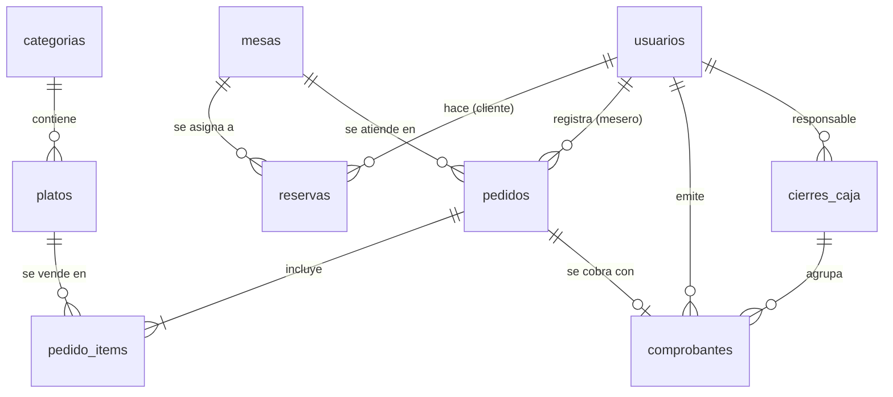

# Estructura de la base de datos

- Motor: SQLite (archivo `data/sigr.db`), acceso con Drizzle ORM y cliente libsql.
- Definición: `src/lib/db/schema.ts`. Migraciones SQL versionadas en `drizzle/`.
- Llaves foráneas activas. Montos en COP enteros. Fechas como milisegundos UTC (`timestamp_ms`).
- Roles y estados se guardan como texto y se validan en `src/lib/domain/constantes.ts`.

## Diagrama entidad-relación

## Tablas

### usuarios
| Columna | Tipo | Restricciones |
|---|---|---|
| id | integer | PK autoincremental |
| nombre | text | obligatorio |
| email | text | obligatorio, único |
| password_hash | text | hash bcrypt |
| rol | text | CLIENTE, MESERO o ADMIN |
| creado_en | integer (ms) | por defecto: ahora |

### categorias
| Columna | Tipo | Restricciones |
|---|---|---|
| id | integer | PK |
| nombre | text | único |

### platos
| Columna | Tipo | Restricciones |
|---|---|---|
| id | integer | PK |
| nombre | text | obligatorio |
| descripcion | text | por defecto "" |
| precio | integer | COP, mayor que 0 (validado en la aplicación) |
| disponible | integer (booleano) | por defecto verdadero |
| categoria_id | integer | FK → categorias, `ON DELETE RESTRICT` |

### mesas
| Columna | Tipo | Restricciones |
|---|---|---|
| id | integer | PK |
| numero | integer | único |
| capacidad | integer | número de personas |

### reservas
| Columna | Tipo | Restricciones |
|---|---|---|
| id | integer | PK |
| cliente_id | integer | FK → usuarios |
| mesa_id | integer | FK → mesas |
| inicio, fin | integer (ms) | fin = inicio + 120 min |
| personas | integer | 1 a 20 |
| estado | text | PENDIENTE, CONFIRMADA o CANCELADA |
| creado_en | integer (ms) | |

Índice `reservas_mesa_inicio_idx (mesa_id, inicio)` para la búsqueda de cruces.

### pedidos
| Columna | Tipo | Restricciones |
|---|---|---|
| id | integer | PK |
| mesa_id | integer | FK → mesas |
| mesero_id | integer | FK → usuarios |
| estado | text | PENDIENTE, EN_PREPARACION, ENTREGADO, PAGADO o CANCELADO |
| creado_en, actualizado_en | integer (ms) | |

### pedido_items
| Columna | Tipo | Restricciones |
|---|---|---|
| id | integer | PK |
| pedido_id | integer | FK → pedidos, `ON DELETE CASCADE` |
| plato_id | integer | FK → platos |
| nombre_plato | text | copia al momento del pedido |
| precio_unitario | integer | copia al momento del pedido |
| cantidad | integer | 1 a 50 |

### comprobantes
| Columna | Tipo | Restricciones |
|---|---|---|
| id | integer | PK |
| numero | integer | único, consecutivo |
| pedido_id | integer | FK → pedidos, único (un comprobante por pedido) |
| total | integer | suma de precio_unitario × cantidad |
| emitido_en | integer (ms) | |
| emitido_por_id | integer | FK → usuarios |
| cierre_id | integer | FK → cierres_caja; nulo mientras la caja está abierta |

### cierres_caja
| Columna | Tipo | Restricciones |
|---|---|---|
| id | integer | PK |
| fecha_hora | integer (ms) | |
| responsable_id | integer | FK → usuarios |
| total | integer | se guarda al cerrar; no se recalcula |
| cantidad_comprobantes | integer | |

## Reglas que dependen de los datos

- **Transiciones de pedido:** PENDIENTE → EN_PREPARACION → ENTREGADO → PAGADO; PENDIENTE o EN_PREPARACION → CANCELADO. El paso a PAGADO solo ocurre al emitir el comprobante.
- **Disponibilidad de reservas:** una mesa está libre si tiene capacidad suficiente y no tiene una reserva no cancelada que se cruce con `[inicio, fin)`. Se asigna la mesa libre más pequeña.
- **Cierre de caja:** agrupa todos los comprobantes con `cierre_id` nulo dentro de una transacción.
