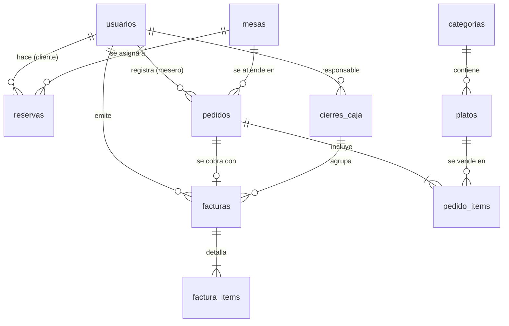

# Estructura de la base de datos

- Motor: SQLite (archivo `data/sigr.db`), acceso con Drizzle ORM y cliente libsql.
- Definición: `src/lib/db/schema.ts`. Migraciones SQL versionadas en `drizzle/` (aplicadas en orden por `npm run db:migrate`).
- Llaves foráneas activas. Montos en COP enteros. Fechas como milisegundos UTC (`timestamp_ms`). Jornadas como texto `AAAA-MM-DD` (hora de Bogotá).
- Roles, estados, medios de pago y tipos de documento se guardan como texto y se validan en `src/lib/domain/constantes.ts`.

## Migraciones

| Archivo | Versión | Contenido |
|---|---|---|
| `0000_init.sql` | v1.0.0 | Esquema inicial (incluía `comprobantes`) |
| `0001_facturacion.sql` | v1.1.0 | Crea `facturas` y `factura_items` |
| `0002_migrar_comprobantes_a_facturas.sql` | v1.1.0 | Datos: convierte cada comprobante en factura (mismo número, total, detalle y cierre) |
| `0003_eliminar_comprobantes.sql` | v1.1.0 | Elimina la tabla `comprobantes` |
| `0004_jornada_y_turno.sql` | v1.1.0 | Agrega `jornada` a facturas y `jornada`/`turno` a cierres |
| `0005_completar_jornadas.sql` | v1.1.0 | Datos: calcula la jornada (Bogotá) y el turno de registros existentes |
| `0006_indices_jornada.sql` | v1.1.0 | Índice único (jornada, turno) e índice de facturas por jornada |

La prueba `tests/integracion/migraciones.test.ts` crea una base de datos con el esquema v1.0.0, inserta datos y verifica la actualización completa.

## Diagrama entidad-relación

## Tablas

### usuarios
| Columna | Tipo | Restricciones |
|---|---|---|
| id | integer | PK autoincremental |
| nombre | text | obligatorio |
| email | text | obligatorio, único |
| password_hash | text | hash bcrypt |
| rol | text | CLIENTE, MESERO o ADMIN |
| creado_en | integer (ms) | por defecto: ahora |

### categorias
| Columna | Tipo | Restricciones |
|---|---|---|
| id | integer | PK |
| nombre | text | único |

### platos
| Columna | Tipo | Restricciones |
|---|---|---|
| id | integer | PK |
| nombre | text | obligatorio |
| descripcion | text | por defecto "" |
| precio | integer | COP, mayor que 0, con impuesto al consumo incluido |
| disponible | integer (booleano) | por defecto verdadero |
| categoria_id | integer | FK → categorias, `ON DELETE RESTRICT` |

### mesas
| Columna | Tipo | Restricciones |
|---|---|---|
| id | integer | PK |
| numero | integer | único |
| capacidad | integer | número de personas |

### reservas
| Columna | Tipo | Restricciones |
|---|---|---|
| id | integer | PK |
| cliente_id | integer | FK → usuarios |
| mesa_id | integer | FK → mesas |
| inicio, fin | integer (ms) | fin = inicio + 120 min |
| personas | integer | 1 a 20 |
| estado | text | PENDIENTE, CONFIRMADA o CANCELADA |
| creado_en | integer (ms) | |

Índice `reservas_mesa_inicio_idx (mesa_id, inicio)`.

### pedidos
| Columna | Tipo | Restricciones |
|---|---|---|
| id | integer | PK |
| mesa_id | integer | FK → mesas |
| mesero_id | integer | FK → usuarios |
| estado | text | PENDIENTE, EN_PREPARACION, ENTREGADO, PAGADO o CANCELADO |
| creado_en, actualizado_en | integer (ms) | |

### pedido_items
| Columna | Tipo | Restricciones |
|---|---|---|
| id | integer | PK |
| pedido_id | integer | FK → pedidos, `ON DELETE CASCADE` |
| plato_id | integer | FK → platos |
| nombre_plato | text | copia al momento del pedido |
| precio_unitario | integer | copia al momento del pedido |
| cantidad | integer | 1 a 50 |

### facturas (v1.1.0)
| Columna | Tipo | Restricciones |
|---|---|---|
| id | integer | PK |
| prefijo | text | por defecto `FA` |
| numero | integer | **único**, consecutivo |
| pedido_id | integer | FK → pedidos, **único** (un pedido, una factura) |
| emitida_en | integer (ms) | |
| emitida_por_id | integer | FK → usuarios |
| emisor_razon_social, emisor_nit, emisor_direccion, emisor_telefono | text | copia de los datos del restaurante |
| cliente_nombre | text | por defecto «Consumidor final» |
| cliente_tipo_documento | text | CC, CE, NIT o PAS (nulo si consumidor final) |
| cliente_numero_documento, cliente_email | text | opcionales |
| subtotal | integer | base sin impuesto = round(total / 1,08) |
| tasa_impuesto_consumo | integer | porcentaje aplicado (8) |
| impuesto_consumo | integer | total − subtotal |
| total | integer | Σ valor_total del detalle |
| medio_pago | text | EFECTIVO, TARJETA, TRANSFERENCIA (NO_REGISTRADO solo en facturas migradas) |
| mesa_numero | integer | copia |
| jornada | text | AAAA-MM-DD, día de emisión en hora de Bogotá |
| cierre_id | integer | FK → cierres_caja; nulo mientras está pendiente |

Índice `facturas_jornada_cierre_idx (jornada, cierre_id)`.

### factura_items (v1.1.0)
| Columna | Tipo | Restricciones |
|---|---|---|
| id | integer | PK |
| factura_id | integer | FK → facturas, `ON DELETE RESTRICT` |
| plato_id | integer | FK → platos (referencia) |
| descripcion | text | copia del nombre del plato |
| cantidad | integer | |
| valor_unitario | integer | copia del precio |
| valor_total | integer | cantidad × valor_unitario |

### cierres_caja
| Columna | Tipo | Restricciones |
|---|---|---|
| id | integer | PK |
| jornada | text | AAAA-MM-DD (Bogotá) |
| turno | integer | 1, 2… dentro de la jornada |
| fecha_hora | integer (ms) | momento del cierre |
| responsable_id | integer | FK → usuarios |
| total | integer | se guarda al cerrar; no se recalcula |
| cantidad_comprobantes | integer | cantidad de facturas del cierre (nombre de columna heredado de v1.0.0) |

Índice **único** `cierres_jornada_turno_unico (jornada, turno)`.

## Reglas que dependen de los datos

- **Transiciones de pedido:** PENDIENTE → EN_PREPARACION → ENTREGADO → PAGADO. PENDIENTE o EN_PREPARACION → CANCELADO. El paso a PAGADO solo ocurre al emitir la factura.
- **Disponibilidad de reservas:** la mesa libre más pequeña con capacidad suficiente, sin reservas no canceladas que se crucen con `[inicio, fin)`.
- **Cierre de caja:** agrupa, en una transacción, las facturas con `cierre_id` nulo de **una** jornada y les asigna el cierre.
- **Concurrencia:** SQLite admite un solo escritor. El cliente de BD (`src/lib/db/cliente.ts`) pone en cola las transacciones y escrituras del proceso, para que no fallen con `SQLITE_BUSY` ni bloqueen el servidor.
