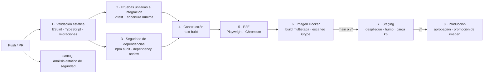

# Pipeline CI/CD

Archivos: `.github/workflows/ci-cd.yml` (pipeline principal), `.github/workflows/codeql.yml` (análisis de seguridad del código), `.github/dependabot.yml` (actualización de dependencias), `Dockerfile`, `scripts/ci/` y `tests/carga/`.

## Cuándo se ejecuta

| Evento | Etapas que corren |
|---|---|
| Push a `feature/**`, `fix/**`, `demo/**` | 1 a 6: validación, pruebas, seguridad, construcción, E2E e imagen (no se publica) |
| Pull request hacia `main` | 1 a 6, más la revisión de dependencias nuevas del PR y CodeQL |
| Push a `main` (merge) | 1 a 7: se publica la imagen en GHCR y se despliega en staging |
| Etiqueta `v*` (versión) | 1 a 8: además, promoción a producción con aprobación manual |
| Manual (`workflow_dispatch`) | 1 a 7 |

## Etapas



| # | Etapa | Herramientas | Qué detiene el pipeline |
|---|---|---|---|
| 1 | Validación estática | `npm ci`, ESLint, TypeScript, `drizzle-kit check` | Errores de lint o de tipos; migraciones inconsistentes con el esquema |
| 2 | Pruebas unitarias e integración | Vitest, cobertura v8 | Una prueba fallida o cobertura por debajo de los umbrales (líneas 80 %, sentencias 80 %, ramas 70 %, funciones 70 %) |
| 3 | Seguridad de dependencias | `npm audit` (`npm run auditoria`), `dependency-review-action` en PR | Vulnerabilidades en dependencias de producción, o altas o críticas en cualquier dependencia |
| 4 | Construcción | `next build` | Errores de compilación. La compilación se guarda como artefacto y la reutiliza la etapa 5 |
| 5 | E2E | Playwright (Chromium) | Fallo de cualquiera de los 13 flujos de usuario. Se guardan el reporte HTML y las trazas |
| 6 | Imagen | Docker Buildx (multietapa, caché de GitHub Actions), Grype | Error de construcción o vulnerabilidades críticas con corrección disponible. En `main` y en las etiquetas publica `ghcr.io/<repo>:sha-<commit>` |
| 7 | Staging | Docker, `curl` (pruebas de humo), k6 (carga) | La aplicación no responde a `/api/salud`, falla una prueba de humo o no se cumple un umbral de carga |
| 8 | Producción | `docker buildx imagetools` | No hay aprobación, porque el entorno `produccion` exige revisor. Promueve la **misma imagen** de staging con las etiquetas `<versión>` y `latest`, sin recompilar |

## Requisitos no funcionales que se validan

| Requisito | Técnica | Dónde | Umbral |
|---|---|---|---|
| Rendimiento | Prueba de carga con k6: 20 usuarios simultáneos durante 20 s sobre menú, login y salud | Etapa 7 (`tests/carga/staging.js`) | p95 < 800 ms (menú, login); p95 < 300 ms (salud) |
| Disponibilidad | `/api/salud` (aplicación y BD), `HEALTHCHECK` del contenedor, errores bajo carga | Etapas 6 y 7 | < 1 % de solicitudes fallidas; contenedor *healthy* |
| Seguridad del código | CodeQL (`security-extended`) | Workflow `codeql.yml` | Alertas en la pestaña *Security* |
| Seguridad de dependencias | `npm audit`, revisión de dependencias del PR, Dependabot | Etapa 3 y semanal | 0 en producción; ninguna alta o crítica |
| Seguridad de la imagen | Escaneo de vulnerabilidades del contenedor con Grype | Etapa 6 | Sin críticas corregibles |
| Control de acceso | Pruebas de humo: rutas protegidas → 307/401 | Etapa 7 | Todas responden como se espera |
| Calidad funcional | 85 pruebas Vitest + 13 E2E; cobertura mínima | Etapas 2 y 5 | 100 % aprobadas |

## Buenas prácticas aplicadas

- **Puertas de calidad en cadena:** cada etapa depende de la anterior; un fallo detiene el despliegue.
- **Construir una vez, desplegar la misma imagen:** producción usa exactamente la imagen probada en staging (`sha-<commit>`).
- **Dependencias reproducibles:** `npm ci` con `package-lock.json`.
- **Acciones fijadas por SHA:** las acciones de GitHub se referencian por commit, con la versión en un comentario, y Dependabot las actualiza.
- **Permisos mínimos:** `contents: read` por defecto; `packages: write` solo en los jobs que publican.
- **Imagen endurecida:**
  - Multietapa, con solo dependencias de producción.
  - Sin npm ni yarn en la imagen final.
  - Usuario sin privilegios y `HEALTHCHECK`.
- **Artefactos para diagnóstico:** reportes de cobertura, JUnit, Playwright con trazas, k6 y registros de staging.
- **Despliegue controlado:** entorno `produccion` con aprobación manual y promoción por etiqueta de versión.

## Configuración necesaria en GitHub (una vez)

1. **Settings → Environments:**
   - Crear `staging`.
   - Crear `produccion` con *Required reviewers* (el responsable de la configuración).
2. **Settings → Rules → Rulesets** (o *Branches*), para `main`:
   - Exigir PR.
   - Exigir que pasen los checks `1 · Validación estática` a `6 · Imagen Docker y escaneo` y `Análisis CodeQL`.
3. **Packages:** la primera publicación crea `ghcr.io/<usuario>/<repo>`. Su visibilidad se ajusta en la configuración del paquete.

## Ejecución local de las mismas verificaciones

```bash
npm run verificar        # lint, tipos, pruebas y build (etapas 1, 2 y 4)
npm run auditoria        # etapa 3
npm run test:e2e         # etapa 5
docker build -t sigr:local .                                      # etapa 6
docker run -d -p 3000:3000 -e SESSION_SECRET=<clave-larga> -e SEMBRAR_DATOS_DEMO=1 -e COOKIE_SEGURA=false sigr:local
bash scripts/ci/esperar-salud.sh http://localhost:3000            # etapa 7
bash scripts/ci/pruebas-humo.sh http://localhost:3000
BASE_URL=http://localhost:3000 k6 run tests/carga/staging.js
```

## Cómo escalar el pipeline

- **Producción real:** reemplazar el paso simulado de la etapa 8 por un despliegue a un servidor o servicio de contenedores, por ejemplo con `docker pull` y reinicio, Kubernetes, Azure Container Apps o Cloud Run. Se puede usar despliegue *blue-green* o *canary*, con reversión automática si `/api/salud` falla.
- **Varias instancias:** migrar SQLite a PostgreSQL y el bus de eventos en memoria a Redis (ver `docs/despliegue.md` §7).
- **Equipos más grandes:**
  - Matriz de pruebas por versión de Node o navegador.
  - Pruebas E2E en paralelo (*sharding*).
  - Entornos efímeros por PR.
  - Revisión de código obligatoria (CODEOWNERS).
- **Observabilidad:** métricas y alertas sobre el entorno desplegado, y pruebas de carga más largas programadas, por ejemplo cada noche.
